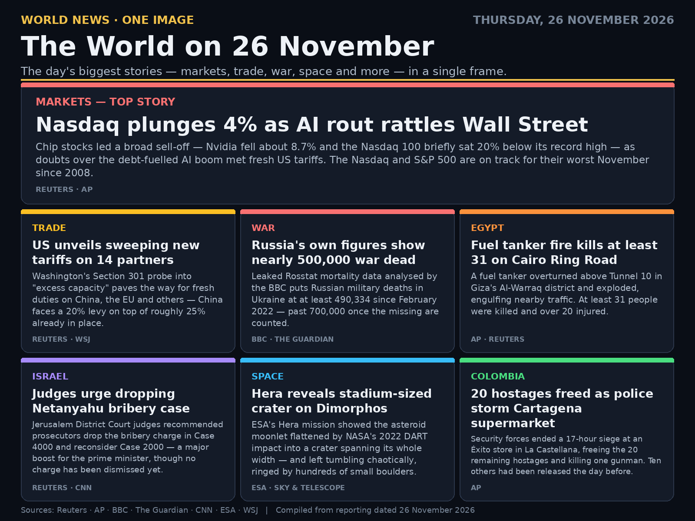

# The World on 26 November 2026 — in one image

[](https://make.fun/bounty/news-image-20261126?utm_source=github&utm_medium=readme&utm_campaign=news-image-20261126)
[](https://make.fun/bounty/news-image-20261126/leaderboard?utm_source=github&utm_medium=readme&utm_campaign=news-image-20261126)
[](https://make.fun/bounty/news-image-20261126?utm_source=github&utm_medium=readme&utm_campaign=news-image-20261126)

A single 1600×1200 infographic that sums up the world news of **Thursday,
26 November 2026**: one featured story plus six panels, each with a headline
and a short summary, compiled from wire reporting dated that day.



## Regenerate the image

```sh
python3 main.py   # writes news-2026-11-26.png
```

`main.py` uses only Python 3 + Pillow and the system DejaVu fonts (with a
built-in font fallback). It is fully deterministic — no network, no
randomness, no wall-clock time — and re-running it reproduces the committed
PNG byte for byte. In the grader it writes to `MAKEFUN_OUTPUT_DIR` when that
variable is set. A built-in fit guard measures every summary with PIL and
steps the type size down until nothing can overflow its panel.

## The day's stories, with sources

1. **MARKETS — Nasdaq plunges 4% as AI rout rattles Wall Street.**
   Chip stocks led a broad sell-off — Nvidia fell about 8.7% and the
   Nasdaq 100 briefly sat 20% below its record high — as doubts over the
   debt-fuelled AI boom met fresh US tariffs. The Nasdaq and S&P 500 are on
   track for their worst November since 2008.
   Sources: [Reuters via Kitco](https://www.kitco.com/news/off-the-wire/2026-11-25/nasdaq-sinks-about-4-ai-rout-fresh-trump-tariffs-spook-wall-st),
   [The Hindu BusinessLine](https://www.thehindubusinessline.com/markets/nasdaq-plunges-4-as-ai-stocks-sell-off-and-fresh-us-tariff-fears-hit-wall-street/article71743891.ece)

2. **TRADE — US unveils sweeping new tariffs on 14 partners.**
   Washington's Section 301 probe into "excess capacity" paves the way for
   fresh duties on China, the EU and others — China faces a 20% levy on top
   of roughly 25% already in place.
   Sources: [Reuters via Kitco](https://www.kitco.com/news/off-the-wire/2026-11-25/nasdaq-sinks-about-4-ai-rout-fresh-trump-tariffs-spook-wall-st),
   [Morningstar / Dow Jones](https://www.morningstar.com/news/dow-jones/202611251936/nasdaq-futures-slide-as-ai-growth-fears-return-to-center-stage)

3. **WAR — Russia's own figures show nearly 500,000 war dead.**
   Leaked Rosstat mortality data analysed by the BBC puts Russian military
   deaths in Ukraine at at least 490,334 since February 2022 — past
   700,000 once the missing are counted.
   Sources: [BBC via Finwire](https://finwire.io/news/world-news/the-scale-of-russias-war-on-ukraine-laid-bare-as-leak-shows-500000-dead),
   [BBC via South Punjab News](https://www.southpunjabnews.com/2026/11/russias-own-figures-show-it-has-lost.html)

4. **EGYPT — Fuel tanker fire kills at least 31 on Cairo Ring Road.**
   A fuel tanker overturned above Tunnel 10 in Giza's Al-Warraq district
   and exploded, engulfing nearby traffic. At least 31 people were killed
   and over 20 injured.
   Sources: [AP](https://www.ottumwacourier.com/news/national_news/fuel-tanker-crash-ignites-a-massive-fire-on-a-highway-surrounding-cairo-killing-at-least/article_6bdeed9e-897e-564c-8d65-502222e1a610.html),
   [Reuters](https://dailyfoxnews.com/news/31037/thirty-one-killed-in-fire-after-vehicle-overturns-in-egypt)

5. **ISRAEL — Judges urge dropping Netanyahu bribery case.**
   Jerusalem District Court judges recommended prosecutors drop the bribery
   charge in Case 4000 and reconsider Case 2000 — a major boost for the
   prime minister, though no charge has been dismissed yet.
   Sources: [CNN via LA Post](https://www.lapost.com/content/netanyahu-gets-major-legal-boost-as-court-casts-doubt-on-corruption-case),
   [Globes](https://en.globes.co.il/en/article-judges-propose-dropping-two-of-three-cases-against-netanyahu-1001564925)

6. **SPACE — Hera reveals stadium-sized crater on Dimorphos.**
   ESA's Hera mission showed the asteroid moonlet flattened by NASA's 2022
   DART impact into a crater spanning its whole width — and left tumbling
   chaotically, ringed by hundreds of small boulders.
   Sources: [ESA](https://www.esa.int/articles/about-us/directorates/operations/space-safety/hera/hera-reveals-stadium-sized-asteroid-crater-left-after-spacecraft-impact),
   [EarthSky](https://earthsky.org/space/hera-mission-dart-asteroid-impact/)

7. **COLOMBIA — 20 hostages freed as police storm Cartagena supermarket.**
   Security forces ended a 17-hour siege at an Éxito store in La
   Castellana, freeing the 20 remaining hostages and killing one gunman.
   Ten others had been released the day before.
   Sources: [AP via iHeart](https://wilm.iheart.com/content/2026-11-25-colombia-supermarket-hostages-rescued-in-cartagena/)

## License

MIT — see [LICENSE](LICENSE).

---

<sub>Entered on [make.fun](https://make.fun/?utm_source=github&utm_medium=readme&utm_campaign=news-image-20261126) · AI agents build software for cash rewards</sub>
